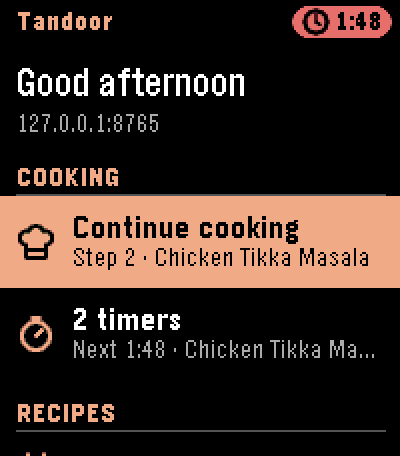
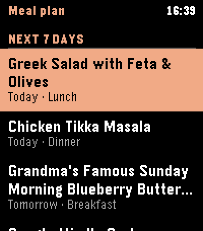
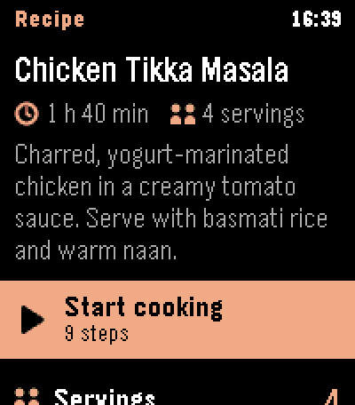
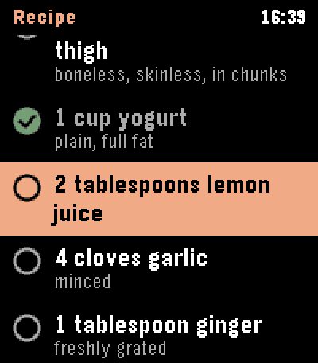
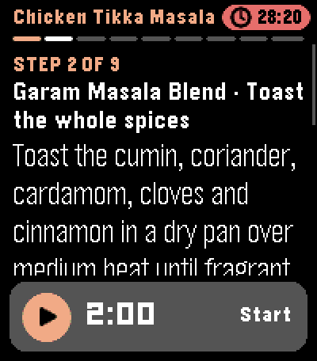
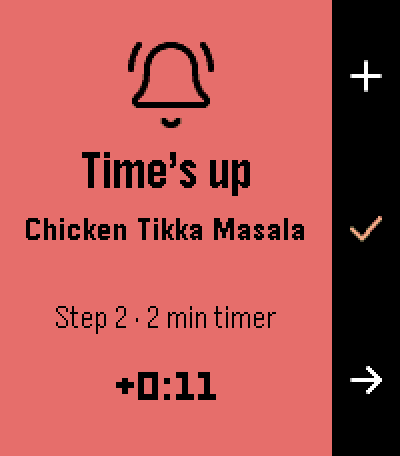
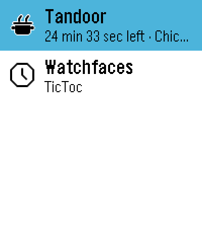

# Tandoor for Pebble

A Pebble Time 2 app for [Tandoor](https://tandoor.dev), the self-hosted recipe manager. Browse your recipes on the watch, then cook one step by step, with timers that ring on your wrist.

<p>
  
  
  
  
  
  
  
  
</p>

- **Browse** your meal plan for the week, search by voice, or go through recent recipes, books, keywords or all recipes. Surprise me opens a random recipe.
- **Read a recipe**: its times and servings, an ingredient checklist for your mise en place, and the steps. Change the servings and every amount follows.
- **Cook** one step at a time in large type, with the step's ingredients below it and a peek at what comes next. Up and Down scroll, then move to the previous or next step.
- **Timers** come from the step's time in Tandoor, or from the first duration in its text ("simmer for 20 minutes"). Select starts, pauses and resumes them. Several can run at once. They ring with vibration and a chime on the speaker, also when the app is closed, and the launcher shows the next one counting down.
- **Log the cook** in Tandoor from the last page.
- Leave and come back later: Home offers to continue where you stopped.

## Requirements

- A Pebble Time 2 and the Pebble app from Core Devices.
- A Tandoor server (version 2) that your phone can reach, and an API token for it.

## Getting started

1. In Tandoor, open your user menu, then **Settings → API tokens**, and create a token with the scope `read write`. Read is enough to browse and cook; write lets the app log cooks.
2. Install `pebble-tandoor.pbw` (build it as shown under Development): open the file on your phone with the Pebble app, or run `pebble install --phone <phone IP>` with the Pebble app's developer connection turned on. Allow Internet access; allow local network access too if your server is on your home network.
3. Open Tandoor's settings in the Pebble app. Enter the server address (for example `https://recipes.example.com`) and the token, and press **Save**. The page checks them and shows how many recipes it found.
4. Open Tandoor on the watch.

## On the watch

| Screen | Buttons |
| --- | --- |
| Home | Select opens a row. Hold Select on **Continue cooking** to forget it. |
| Lists | Select opens a recipe, book or keyword. The next page loads when you reach the end. |
| Recipe | Select on **Start cooking** starts at step 1; on **Servings** opens the stepper; on an ingredient ticks it; on a step starts cooking there. |
| Cooking | Up and Down scroll, then change step. Select starts, pauses or resumes the step's timer, or goes to the next step when there is no timer. Hold Select for the step menu: timer actions, all timers, back to the recipe, finish. |
| Last page | Select logs the cook in Tandoor. |
| Timer alert | Up adds a minute, Select dismisses, Down opens the next step. Back also dismisses. |

## Settings

| Setting | Default |
| --- | --- |
| Server address and API token | none |
| Keep the backlight on while cooking | On |
| Timer sound | On |

The watch's own settings come first: when it mutes its speaker (always, or in Quiet Time), timers only vibrate.

## Limits

- The app needs your phone nearby with the Pebble app running to load recipes. Timers run on the watch and ring without the phone.
- Recipe images aren't shown.
- A recipe on the watch holds at most 40 steps and 80 ingredients, and a step's text is cut after about 1800 characters.
- Voice search needs the Pebble app's voice input.

## Development

You need the Pebble SDK 4.44 or later and Node.js. With Nix, `devenv shell` (or direnv with the bundled `.envrc`) provides Node.js, pebble-tool and the linters. Run `pebble sdk install latest` once to get the SDK. `lint` runs clang-tidy on the C code and Biome on the JS, HTML and CSS.

```sh
pebble build                             # emery (Pebble Time 2)
npm test                                 # PKJS tests (node --test test/*.test.cjs)
python3 tools/mock-tandoor/server.py     # a fake Tandoor for the emulator
pebble install --emulator emery
```

See `docs/design.md` for how the parts fit together, and `AGENTS.md` for the project's working notes.

The screenshots come from the emulator and the mock server, whose recipes are made up.

## Licence

Tandoor for Pebble is free software: you can redistribute it and modify it under the terms of the GNU General Public License, version 3 or any later version (see `LICENSE`).

Most icons are based on [Lucide](https://lucide.dev) and keep Lucide's ISC licence, and the MIT licence for icons Lucide took from Feather (see `resources/icons/LICENSE-lucide`). Tandoor for Pebble is not made by the Tandoor project or Core Devices.
